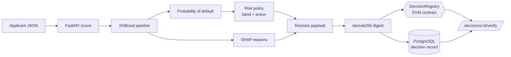

# CreditTrace

**Explainable credit-risk scoring with tamper-evident, on-chain decision records.**

CreditTrace scores microloan applications with a gradient-boosted model, explains every
decision with SHAP, and writes a cryptographic fingerprint of each decision to an EVM
smart contract. Later, anyone who has the original decision can prove — without trusting
the lender's database — that the decision existed at a given block and has not changed
since.

> The main pipeline runs on a **documented synthetic generator** — chosen on purpose so
> the ground-truth risk drivers are known and SHAP can be checked against them (no real
> person or company is involved). The approach is **also validated on real data**: the
> public UCI *German Credit* dataset (`python -m app.ml.benchmark`). The blockchain runs
> locally (Anvil or an in-memory EVM); nothing is sent to a public network and no token
> has any value.

[](.github/workflows/ci.yml)
[](pyproject.toml)
[](contracts/src/DecisionRegistry.sol)
[](LICENSE)

---

## Why it exists

An automatic lending decision has two needs that are often handled separately:

1. **It must be explainable.** A credit officer (and a regulator) must know *why* an
   application was declined, in terms of real features, not model internals.
2. **It must have integrity.** If there is a dispute later, the lender must be able to
   show the decision as it was made and prove the record was not edited afterward.

CreditTrace does both in one flow. The model returns a probability of default and a
ranked list of plain-language reasons. The service then builds a `keccak256` fingerprint
(a "digest") of the full decision — the features, the model version, the score, and the
outcome — and writes only that 32-byte digest to the chain. The chain never sees
applicant data, so you get proof of integrity with no privacy cost.

## How it works



A decision is **verified** when the digest built again from the stored record matches
the stored digest, and that digest is on the chain. If someone changes one stored field,
the new digest is different and verification returns `digest_mismatch`. That is the proof
of tampering.

See [`docs/architecture.md`](docs/architecture.md) for the full design, the
[ADRs](docs/adr/) for the main choices, and [`docs/threat-model.md`](docs/threat-model.md)
for the STRIDE analysis.

## Quickstart

### Option A — one command (Docker)

```bash
cp .env.example .env
docker compose up --build
# trains a model, deploys the contract to Anvil, serves the API
```

Open <http://localhost:8000/docs> for the interactive API.

### Option B — local Python

```bash
python -m venv .venv && source .venv/bin/activate
make install          # pip install -e ".[dev]"
make compile          # compile the Solidity contract (Node + solc-js)
make train            # train the model -> ml/artifacts/<version>
make test             # full test suite
make demo             # end-to-end: train, deploy, score, anchor, verify, tamper
```

`make demo` is the fastest way to see the whole system work. It runs in one process
against an in-memory EVM and a temporary database, so it needs no services.

## The API

| Method | Path | What it does |
|---|---|---|
| `GET` | `/health` | Liveness check |
| `GET` | `/model` | Active model version and training metrics |
| `POST` | `/score` | Score an applicant, store and anchor the decision |
| `GET` | `/decisions/{id}` | Get a stored decision |
| `GET` | `/decisions/{id}/verify` | Rebuild the digest and check it on-chain |

### Example

```bash
curl -s -X POST http://localhost:8000/score -H 'content-type: application/json' -d '{
  "age": 34, "monthly_income": 3200000, "loan_amount": 6000000,
  "loan_term_months": 24, "employment_length_years": 5.0, "debt_to_income": 0.38,
  "num_existing_loans": 1, "num_late_payments_12m": 0, "has_collateral": 1,
  "region": "andina", "loan_purpose": "working_capital"
}'
```

```json
{
  "decision_id": "…",
  "model_version": "m_…",
  "probability": 0.11,
  "score_bps": 1100,
  "band": "low",
  "decision": "approve",
  "reasons": [
    {"feature": "debt_to_income", "label": "Debt-to-income ratio",
     "value": 0.38, "contribution": -0.41, "direction": "decreases_risk"}
  ],
  "anchor": {"enabled": true, "anchored": true,
             "digest": "0x…", "block_number": 2, "already_anchored": false}
}
```

## Project layout

```
app/
  ml/        features, synthetic data, real_data (UCI German Credit), XGBoost model,
             SHAP explanations, benchmark (real-world validation)
  chain/     decision digest, solc-js compile, anchor clients (web3 + in-memory)
  db/        SQLAlchemy models and session
  service.py the flow: score -> store -> anchor -> verify
  main.py    FastAPI endpoints
contracts/   DecisionRegistry.sol + solc-js compiler + Foundry tests
docs/        architecture, ADRs, threat model, and a Spanish study guide (docs/estudio)
```

Two choices are worth noting:

* **The contract stores only digests.** No personal data ever reaches the chain, so you
  get integrity with no privacy cost
  ([ADR-0002](docs/adr/0002-anchor-digest-not-data.md)).
* **Anchoring sits behind an interface.** `ScoringService` depends on an `AnchorClient`
  interface, so it runs the same way against the real contract (Anvil or an in-memory
  EVM) or an in-memory fake. This is what lets the whole system be tested with no
  blockchain at all.

## Testing and quality

* **30 tests** cover the digest, the model, the contract (deployed to an in-memory EVM),
  the service, the API, and the **real-data benchmark** (the German Credit loader plus a
  well-fit check that is mutation-proven: the overfit config fails on the train/test gap
  and shuffled labels fail on cross-validated AUC). CI requires at least 80% coverage.
* The **Solidity** contract is tested twice: by the Python suite against the compiled
  bytecode, and by a **Foundry** suite (`forge test`, with a fuzz test) in CI.
* **CI** runs lint (`ruff`), the contract compile plus a check that the committed
  artifact is up to date, the test suite, `bandit` and `gitleaks` security scans, and a
  Docker build.

```bash
make lint          # ruff
make test          # pytest + coverage
cd contracts && forge test   # Foundry (needs Foundry installed)
```

## Model

A scikit-learn `Pipeline` (one-hot `ColumnTransformer` + `XGBClassifier`) trained on a
documented synthetic generator. Because we know the real risk drivers in the generator,
we can check that the SHAP reasons match them. Each trained model gets a content-based
version (`m_<hash>` over the hyper-parameters and a fingerprint of the data) that goes
into every decision digest, so a decision always names the exact model that made it.
Reported metrics: ROC-AUC, KS, and Brier score.

## Real-world benchmark (UCI German Credit)

The synthetic generator validates *explainability*; the real **UCI Statlog German Credit**
dataset (1,000 applicants, vendored under [`datasets/`](datasets/) with full provenance)
validates that the same architecture is **correctly fit on real data** — strong on unseen
folds and with its training score close to its test score. Run `python -m app.ml.benchmark`:

```
model                  CV ROC-AUC         train    test     gap
XGBoost (well-fit)     0.786 +/- 0.026     0.856   0.784   0.072
Logistic regression    0.786 +/- 0.020     0.832   0.804   0.028

top SHAP risk drivers: status (checking account), duration, savings,
                       credit_history, purpose, amount
verdict: well-fit — strong cross-validated AUC with train and test scores close
```

Two things are deliberate and worth noting:

* **The score is ~0.78, not 1.0.** German Credit tops out around 0.78–0.80 ROC-AUC in the
  literature; a model reporting ~1.0 here would signal a leak. The chosen XGBoost config is
  **not** a capacity cut — a deeper, unregularised model scores *lower* in cross-validation
  (it memorises: train AUC 1.0, CV 0.77), so the regularised config generalises better.
* **SHAP recovers the known drivers.** Checking-account status is the dominant predictor in
  the German Credit literature, and it comes out on top here — the explainability holds on
  real applicants, not only on the synthetic set.

## For study

This repository is also a study project. [`docs/estudio/`](docs/estudio/) has a guided
walkthrough in Spanish: the risk model, SHAP explanations, the on-chain anchoring, the
architecture, and a set of interview questions with answers.

## License

[MIT](LICENSE) © Angelo David Padilla Romero
