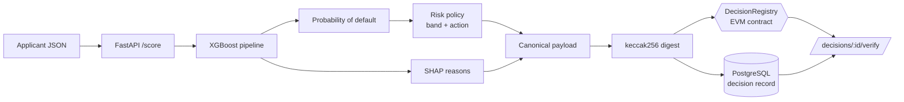

# CreditTrace

**Explainable credit-risk scoring with tamper-evident, on-chain decision anchoring.**

CreditTrace scores microloan applications with a gradient-boosted model, explains
every decision with SHAP, and anchors a cryptographic digest of each decision on an
EVM smart contract. Months later, anyone holding the original decision can prove —
without trusting the lender's database — that the decision existed at a given block
and has not been altered since.

> All data is **synthetic**. No real person, client or institution is involved, and
> the blockchain runs locally (Anvil / an in-memory EVM). Nothing is ever published
> to a public network and no token has any value.

[](.github/workflows/ci.yml)
[](pyproject.toml)
[](contracts/src/DecisionRegistry.sol)
[](LICENSE)

---

## Why it exists

Automated lending decisions carry two obligations that are usually handled
separately and badly:

1. **Explainability** — a credit officer (and a regulator) must know *why* an
   application was declined, in terms of real features, not model internals.
2. **Integrity** — if a dispute arises, the lender must be able to show the decision
   as it was made, and prove the record was not edited after the fact.

CreditTrace addresses both in one pipeline. The model produces a calibrated
probability of default and a ranked list of human-readable reasons; the service then
computes a `keccak256` digest over the *canonical decision payload* (features + model
version + score + outcome) and anchors that 32-byte digest on-chain. The chain never
sees applicant data — only the digest — so integrity is provable without leaking
anything.

## How it works



A decision is **verified** when the digest recomputed from the stored record matches
the stored digest *and* that digest is anchored on-chain. If a single stored field is
altered, the recomputed digest changes and verification returns `digest_mismatch` —
that is the tamper evidence.

See [`docs/architecture.md`](docs/architecture.md) for the full design, the
[ADRs](docs/adr/) for the key decisions, and
[`docs/threat-model.md`](docs/threat-model.md) for the STRIDE analysis.

## Quickstart

### Option A — one command (Docker)

```bash
cp .env.example .env
docker compose up --build
# trains a model, deploys the registry to Anvil, serves the API
```

Open <http://localhost:8000/docs> for the interactive API.

### Option B — local Python

```bash
python -m venv .venv && source .venv/bin/activate
make install          # pip install -e ".[dev]"
make compile          # compile the Solidity contract (Node + solc-js)
make train            # train the model -> ml/artifacts/<version>
make test             # full test suite
make demo             # end-to-end: train, deploy, score, anchor, verify, tamper
```

`make demo` is the fastest way to see the whole system work; it runs entirely
in-process against an in-memory EVM and a temporary database — no services needed.

## The API

| Method | Path | Purpose |
|---|---|---|
| `GET` | `/health` | Liveness probe |
| `GET` | `/model` | Active model version and training metrics |
| `POST` | `/score` | Score an applicant, store and anchor the decision |
| `GET` | `/decisions/{id}` | Retrieve a stored decision |
| `GET` | `/decisions/{id}/verify` | Recompute the digest and check it on-chain |

### Example

```bash
curl -s -X POST http://localhost:8000/score -H 'content-type: application/json' -d '{
  "age": 34, "monthly_income": 3200000, "loan_amount": 6000000,
  "loan_term_months": 24, "employment_length_years": 5.0, "debt_to_income": 0.38,
  "num_existing_loans": 1, "num_late_payments_12m": 0, "has_collateral": 1,
  "region": "andina", "loan_purpose": "working_capital"
}'
```

```json
{
  "decision_id": "…",
  "model_version": "m_…",
  "probability": 0.11,
  "score_bps": 1100,
  "band": "low",
  "decision": "approve",
  "reasons": [
    {"feature": "debt_to_income", "label": "Debt-to-income ratio",
     "value": 0.38, "contribution": -0.41, "direction": "decreases_risk"}
  ],
  "anchor": {"enabled": true, "anchored": true,
             "digest": "0x…", "block_number": 2, "already_anchored": false}
}
```

## Architecture at a glance

```
app/
  ml/        features · synthetic data · XGBoost model · SHAP explanations
  chain/     canonical digest · solc-js compile · anchor clients (web3 + in-memory)
  db/        SQLAlchemy models and session
  service.py orchestration: score -> persist -> anchor -> verify
  main.py    FastAPI surface
contracts/   DecisionRegistry.sol + solc-js compiler + Foundry tests
docs/        architecture, ADRs, threat model, and a Spanish study guide (docs/estudio)
```

Two design choices are worth calling out:

* **The contract stores only digests.** No PII ever reaches the chain, so integrity
  is provable without a privacy cost ([ADR-0002](docs/adr/0002-anchor-digest-not-data.md)).
* **Anchoring sits behind an interface.** `ScoringService` depends on an
  `AnchorClient` protocol, so it runs identically against the real contract (Anvil or
  an in-memory EVM) or an in-memory fake. That is what lets the whole system be tested
  without any blockchain infrastructure.

## Testing & quality

* **27 tests** cover the digest, the model, the contract (deployed to an in-memory
  EVM), the service and the HTTP API; coverage is enforced at ≥ 80% in CI.
* **Solidity** is tested twice: by the Python suite against the compiled bytecode, and
  by a **Foundry** suite (`forge test`, including a fuzz test) in CI.
* **CI** runs lint (`ruff`), the contract compile + a staleness check on the committed
  artifact, the test suite, `bandit` and `gitleaks` security scans, and a Docker build.

```bash
make lint          # ruff
make test          # pytest + coverage
cd contracts && forge test   # Foundry (requires Foundry installed)
```

## Model

A scikit-learn `Pipeline` (one-hot `ColumnTransformer` + `XGBClassifier`) trained on a
documented synthetic generator whose ground-truth risk drivers are known, so SHAP
attributions can be checked against them. Each trained model gets a content-addressed
version (`m_<hash>` over hyper-parameters + data fingerprint) that is embedded in every
decision digest, so a decision always names the exact model that produced it. Reported
metrics: ROC-AUC, KS and Brier score.

## Project layout for study

This repository is also a study artifact. [`docs/estudio/`](docs/estudio/) contains a
guided walkthrough in Spanish: the risk model, SHAP explainability, the on-chain
anchoring scheme, the architecture, and a set of interview questions with answers.

## License

[MIT](LICENSE) © Angelo David Padilla Romero
