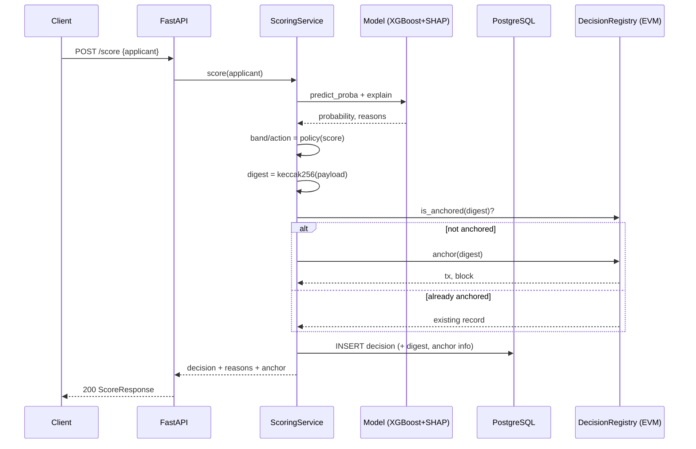
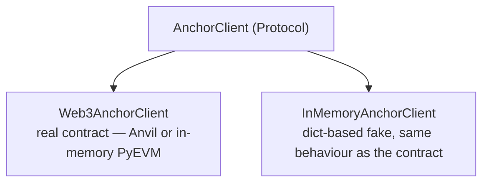

# Architecture

## Goal

Score microloan applications in a way that is **explainable** to a credit officer and
**tamper-evident** to an auditor, without putting applicant data on a public ledger.

## Components

| Layer | Module | What it does |
|---|---|---|
| ML | `app/ml` | Feature list, synthetic data, XGBoost pipeline, SHAP reasons, versioned model store |
| Chain | `app/chain` | Decision payload and `keccak256` digest, contract compile (solc-js), anchor clients |
| Persistence | `app/db` | SQLAlchemy `Decision` model and session |
| Flow | `app/service.py` | `ScoringService`: score -> store -> anchor -> verify |
| API | `app/main.py` | FastAPI endpoints |
| Contract | `contracts/` | `DecisionRegistry.sol`, solc-js compiler, Foundry tests |

## The decision flow



## The decision payload

The digest covers everything needed to rebuild a decision:

```
payload = json(sort_keys, no whitespace) {
    "decision":      "approve" | "review" | "decline",
    "features":      { ...the exact scored features... },
    "model_version": "m_<hash>",
    "score_bps":     <int, probability * 10000>
}
digest = keccak256(payload)       # 32 bytes
```

The serialisation is fixed (sorted keys, no extra whitespace), so the same decision
always gives the same digest, and any change gives a different one. See
[ADR-0003](adr/0003-canonical-serialization.md).

## The contract

`DecisionRegistry` is small on purpose: a write-only registry, with roles, that maps a
`bytes32` digest to `{submitter, timestamp, blockNumber}`.

* `anchor(digest)` — only an allowed scorer; it reverts on a zero digest or on a second
  anchor of the same digest (`AlreadyAnchored`).
* `recordOf(digest)` / `isAnchored(digest)` — public reads used to verify.
* `setScorer` / `transferOwnership` — owner-only access control.

It never receives applicant data ([ADR-0002](adr/0002-anchor-digest-not-data.md)).

## The chain interface

`ScoringService` depends on the `AnchorClient` interface, not on web3 directly:



This is what lets the system be tested with no blockchain, and lets anchoring be turned
off (`CT_CHAIN_ENABLED=false`) for offline scoring.

## Verify and tamper evidence

`GET /decisions/{id}/verify`:

1. Rebuild the digest from the **stored** record.
2. Compare it to the stored digest -> `digest_matches`.
3. Look the digest up on the chain -> `on_chain.anchored`.

| Result | Meaning |
|---|---|
| `verified` | digest matches and is on the chain |
| `digest_mismatch` | a stored field was changed after the decision |
| `not_anchored` | digest matches but was never anchored |
| `chain_disabled` | anchoring was off when the decision was scored |

## Configuration

All settings come from environment variables (`CT_` prefix, see `.env.example`):
database URL, model directory and pinned version, chain on/off, RPC URL, contract
address, signing key, and the risk-band thresholds.

## Deployment

`docker-compose.yml` runs PostgreSQL, Anvil, and the API. The API entrypoint waits for
Anvil, trains a model if there is none, deploys the contract if no address is set, then
serves. In production, the RPC URL and a funded signing key would point at the real
network, and the model would be built in CI and shipped read-only.
